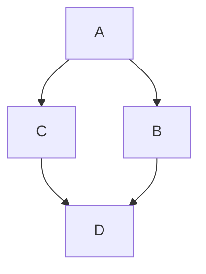
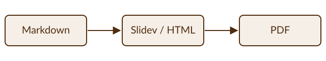

---
# The accent color (title underline, links). Quote it, because # starts a
# comment in YAML. Without this, lump's default (the brown in slidev/style.css)
# is used.
themeConfig:
  primary: '#502d0e'
---

# Example Document

Since lump has an infrastructure in place for turning markdown into PDF, it's practically zero cost to also enable making non-slide PDFs from markdown documents.
In a classroom setting, this is useful for assignment documents, syllabus documents, etc.

Render this to pdf with a command of this form: `lump md2pdf example.md -o example.pdf`.

Below is a quick verification that the various parts of lump work for documents.
Note that manim is not tested here, because animations inside of pdfs aren't a target use case.

## A table

| Item | Value |
|------|-------|
| One  | 1     |
| Two  | 2     |

## Code

```js
console.log('hello');
```

## Mermaid



## SVG image

Images use paths relative to this file (here, `images/pipeline.svg`):



## Math

You can do inline math like this $x = y^2$.
You can also do math blocks:

$$
x = \frac{-b \pm \sqrt{b^2 - 4ac}}{2a}
$$
