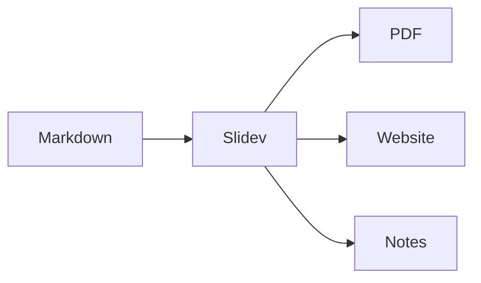
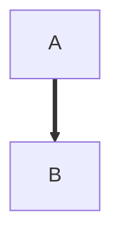

# Example Deck

## A quick demo of some of lump's features

<!--
The first slide of a deck defaults to the "cover" layout.

Four of the five lump commands relate to slides:
- `slides2pdf <deck.md> -o <out.pdf>`          Slidev deck -> PDF (one page per slide)
- `notes2pdf <deck.md> -o <out.pdf>`           Deck's presenter notes -> PDF
- `slides2website <deck.md> -o <out-folder>`   Slidev deck -> static website in a folder (put it anywhere)
- `start <deck.md>`                            Serve a deck live in the browser, for editing
-->

---

# Manim: A Rendered Video

<Vid :start="4.2">
  <video src="/videos/square_to_circle.mp4"></video>
</Vid>

<!--
This slide plays a video rendered by Python Manim (manim/square_to_circle.py).
The video is a 640x360 clip of a few seconds, about 36 KB.

You don't need to use manim to make these videos.
Any mp4 will do.

`<Vid>` gives the video keyboard control
- Click it to let it capture keystrokes
- Space plays and pauses
- Arrows move 5 seconds forward and back
- Shift + arrows moves 1 second forward and back
- `,` and `.` step by one frame back and forward
- Escape returns keyboard control back to the slides

In a pdf, the frame given by `:start` is the one that gets displayed.
The default is 0.1 seconds.

The manim video was made using the Python manim library.
See manim/square_to_circle.py for the Python source.
The python script also says how to set up and use manim.
-->

---

# Manim: Live In The Browser

<Manim src="square_to_circle" />

<!--
The same animation, as a manim-web scene (manim/square_to_circle.ts).
There is no mp4 file for this :)

It starts in step mode: space, the right arrow, or a click goes to the next step (a step ends at each wait of half a second or more), and the left arrow goes back.
The last step hands the arrow keys back to the slides.
The ⚡ button snaps from step to step instead of animating, and the ☰ button switches to a video-style player with a scrub bar.
-->

---

# Code

```python
def fib(n):
    if n < 2:
        return n
    return fib(n - 1) + fib(n - 2)
```

```ts
const squares = [1, 2, 3].map((n) => n * n);
console.log(`squares: ${squares.join(', ')}`);
```

<!--
Fenced code blocks are highlighted (by Shiki), in any language it knows.

Fenced code blocks in notes keep their text exactly, with syntax highlighting:

```python
print(fib(10))
```
-->

---

# Math

- Inline math uses single dollar signs: $ax^2 + bx + c = 0$
- Display math uses `$$` blocks:

$$
x = \frac{-b \pm \sqrt{b^2 - 4ac}}{2a}
$$


- Sums and integrals work from within `aligned` blocks:

$$
\begin{aligned}
\sum_{k=1}^{n} k &= \frac{n(n+1)}{2}
\\
\int_0^1 x^2 \, dx &= \frac{1}{3}
\end{aligned}
$$

<!--
Math is rendered by KaTeX, so any KaTeX-supported TeX works, on slides, in these notes ($e^{i\pi} + 1 = 0$), and in plain documents.
-->

---

# Diagram



<!--
Mermaid diagrams work on slides, in notes, and in plain documents.
In notes, use -.-> or ==> arrows: a plain arrow would end this HTML comment early.



-->

---

# Table

| Language | Typing  | Paradigm        |
|----------|---------|-----------------|
| Scheme   | Dynamic | Functional      |
| Java     | Static  | Object-oriented |
| Go       | Static  | Procedural      |

<!--
Tables use GitHub-flavored Markdown syntax, the same as in plain documents.
-->

---

# SVG Image


<!--
Files in the public/ folder next to this deck are served from the site root, so public/images/pipeline.svg is referenced as /images/pipeline.svg.
Use Markdown image syntax for the simple case, or an  tag when you need to control size and placement (here with UnoCSS classes).
-->

---
layout: two-cols-header
layoutClass: "!grid-rows-[auto_1fr]"
---

# Two Columns

::left::

- Slidev layouts, such as this one
- Presenter notes, collected by `lump notes2pdf`
- Ink: draw on a slide while presenting
- Custom buttons for duplicating slides and adding blank slides during the presentation

::right::

```bash
lump start example.md
lump slides2pdf example.md -o slides.pdf
lump notes2pdf example.md -o notes.pdf
lump slides2website example.md -o site
```
